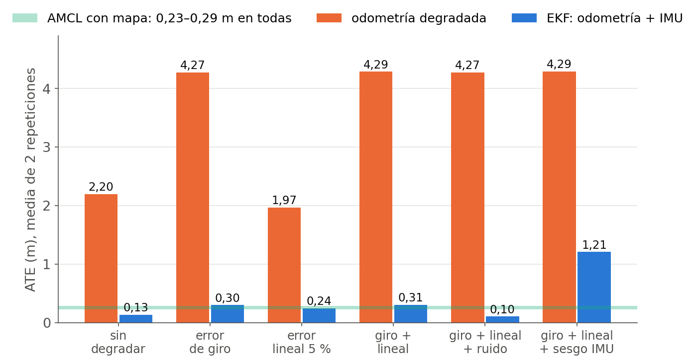
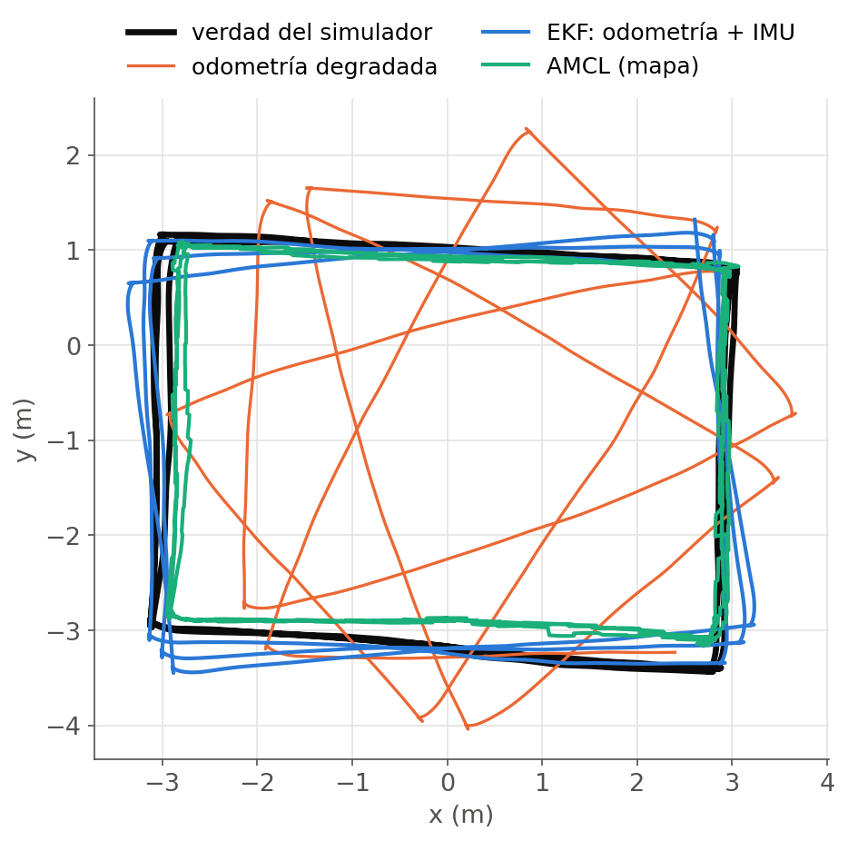
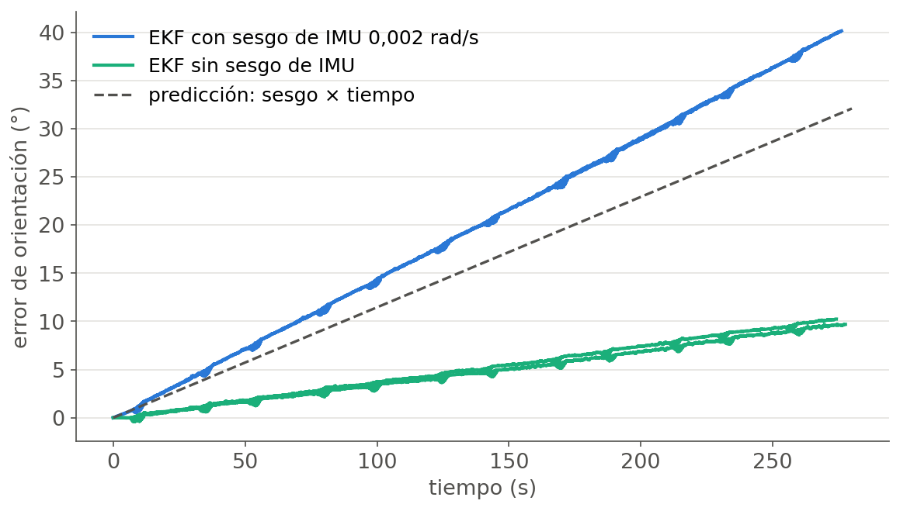
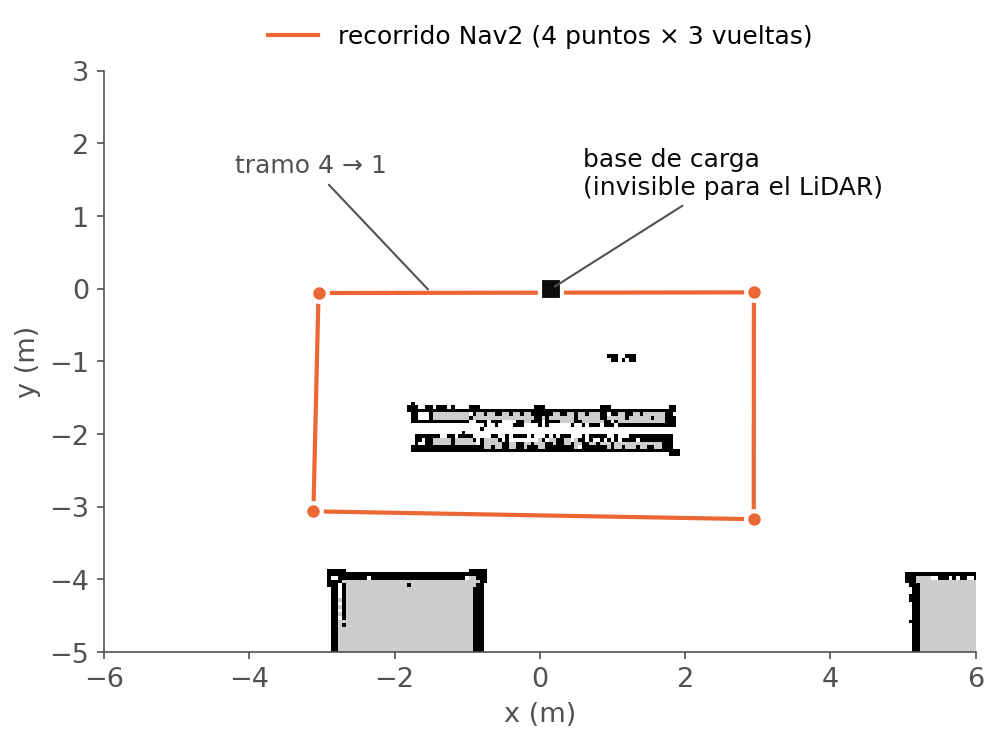

# How much does an EKF fix bad wheel odometry? A measured experiment on a TurtleBot 4

Nav2 navigation with SLAM and AMCL, plus a controlled experiment on sensor fusion with
`robot_localization`: wheel odometry is degraded on purpose with the classic errors of a
differential-drive robot, fused with a gyroscope in an Extended Kalman Filter (EKF), and
measured against the simulator's ground-truth pose.

**Everything runs in simulation** (ROS 2 Jazzy, Gazebo Harmonic, TurtleBot 4, Ubuntu 24.04).



## Main results

Six conditions × 2 repetitions × 3 laps of a ~20 m rectangle (62 m and ~277 s per run);
144 of 144 navigation goals reached. Hypotheses were written down before running the batch.

| Condition | What is degraded | Degraded odometry ATE | EKF ATE | What it shows |
|---|---|---|---|---|
| `nada` | nothing | 2.20 m | **0.13 m** | the simulator's own odometry over-rotates by 6 % |
| `giro` | wheel-base error + yaw-rate bias | 4.27 m | **0.30 m** | the gyroscope fixes rotation errors (÷14) |
| `lineal` | wheel-radius error (5 %) | 1.97 m | 0.24 m | distance scale stays at **1.050**: the gyroscope cannot see speed |
| `ambos` | both | 4.29 m | **0.31 m** | |
| `ruido` | both + white noise | 4.27 m | **0.10 m** | unexpected: better than without noise (see below) |
| `imu_sesgo` | both + gyroscope bias (0.002 rad/s) | 4.29 m | 1.21 m | the filter trusts the biased gyro: **40°** of heading error |

ATE = absolute trajectory error, RMS, aligned at the initial pose. AMCL (map-based
localisation, recorded alongside) stays at 0.23-0.29 m and below 0.35 % final error in
every condition. Full table with Umeyama-aligned ATE, relative pose error and distance /
rotation scale per run: [`LOCALIZACION_EKF/resultados/resumen.txt`](LOCALIZACION_EKF/resultados/resumen.txt).
Detailed write-up (in Spanish): [`LOCALIZACION_EKF/RESULTADOS.md`](LOCALIZACION_EKF/RESULTADOS.md).

| | |
|---|---|
|  |  |
| Condition `ambos`: degraded odometry (orange) drifts by metres; the EKF (blue) and AMCL (green) stay on the ground truth. | With a 0.002 rad/s gyroscope bias the heading error reaches 40°: ~32° predicted by bias × time, plus the ~10° the EKF already had. |

### Hypotheses, written before measuring

| # | Hypothesis | Result |
|---|---|---|
| 1 | The gyroscope fixes rotation errors | ✓ rotation scale 1.256 → 1.009 |
| 2 | The gyroscope does not fix a linear scale error | ✓ distance scale 1.050, identical to the degraded odometry |
| 3 | AMCL does not drift | ✓ final error < 0.35 % in all conditions |
| 4 | White noise does not change the EKF result | ✗ with noise the EKF is *better* (0.10 vs 0.31 m) |
| 5 | A gyroscope bias passes straight into the EKF (~32°) | ~ 40°: it adds to the error the EKF already had |

Hypothesis 4 failed. The likely cause, **not yet verified**: when noise is added, the degraded
odometry also declares a larger covariance, so the filter leans even more on the gyroscope.
`degradar_odom.py --sigma-w-min 0.05` runs the same condition with that covariance and no
noise, which would confirm or rule it out.

## Findings that were not in the plan

- **The simulator's wheel odometry is not perfect**: it over-rotates by 6 % (≈70° of heading
  error after three laps) while distance is exact. The EKF corrects it even with nothing degraded.
- **Orientation of the goals matters.** With every goal facing the same direction, the robot
  turned and un-turned at each corner and rotation errors cancelled out. Those runs are kept in
  `resultados/descartadas_orientacion_fija/` and excluded from the table; the rectangle is now
  always driven turning the same way (as in the UMBmark test).
- **An obstacle Nav2 cannot see.** One leg of the first Nav2 route took twice as long as an
  equally long one. The first hypothesis (the planner detours around the charging dock) was
  wrong: logging `/plan`, ground truth and the bumper showed all 44 logged plans passing within
  4 cm of the dock. It is lower than the LiDAR plane, so it is missing from the SLAM map and from every
  costmap; the robot hit it and Nav2 fell into recovery behaviours (3-6 recoveries, 8.5 m driven
  instead of 6). Details in [`NAV2/RESULTADOS.md`](NAV2/RESULTADOS.md).



## How it works

```
/odom (simulator, used by Nav2) ──► degradar_odom.py ──► /odom_degradada ──┐
Gazebo IMU ──► imu_realista.py (MEMS gyro noise, optional bias) ──► /imu ──┴─► robot_localization EKF ──► /odometry/filtered
/sim_ground_truth_pose ─────────────────────────────────────────────────────────► registrar.py (TUM files) ──► evaluar.py
```

- **Nav2 drives, Gazebo referees, the EKF estimates.** Nav2 navigates with the simulator's
  odometry so every run follows the same route; the EKF runs alongside with
  `publish_tf: false`, so it observes without changing how the robot moves.
- **What is fused:** wheel velocities (forward and yaw rate) and the gyroscope yaw rate.
  Velocities rather than the integrated wheel pose, because the pose already carries the drift;
  only the gyroscope from the IMU, because integrating the accelerometer drifts faster than the
  wheels and Gazebo's orientation is perfect.
- **Degradations** (`degradar_odom.py`): wheel-radius scale, wheel-base (yaw) scale, yaw-rate
  bias and white noise, with covariances consistent with the injected error.
- **Metrics** (`evaluar.py`, no ROS needed): ATE aligned at the start and with Umeyama, relative
  pose error per metre, final error as % of distance, and distance / rotation scale.

## Running it

```bash
bash NAV2/setup_nav2.sh                # installs Nav2, slam_toolbox, robot_localization, TurtleBot 4 sim
bash NAV2/lanzar.sh slam               # build the map driving with Nav2 Goal in RViz
bash NAV2/lanzar.sh guardar-mapa
bash NAV2/lanzar.sh navegar            # Nav2 + AMCL on the saved map (keep it running)

bash LOCALIZACION_EKF/bateria.sh       # 6 conditions × 2 repetitions, then the summary table
python3 LOCALIZACION_EKF/evaluar.py LOCALIZACION_EKF/resultados/2026100*_*/
python3 figuras/figuras.py             # regenerates the figures from the recorded data
```

`python LOCALIZACION_EKF/evaluar.py --prueba` checks the metrics on synthetic data, without ROS.

## Limitations

- Simulation only: ground truth comes for free. On a real platform it would need motion
  capture indoors or RTK GNSS outdoors.
- Two repetitions of one route in one world; Gazebo is almost deterministic, so the spread
  between repetitions says nothing about real-world variability.
- The degraded odometry declares covariances that *know* the injected error. On a real robot
  they would have to be tuned from logged data, and hypothesis 4 shows how much they matter.
- Simple IMU model: white noise and constant bias, no bias random walk or temperature effects.

## Repository layout

| Path | Contents |
|---|---|
| `NAV2/` | Setup and launch scripts, waypoint runner with per-goal timing and recoveries, saved map, Nav2 results |
| `LOCALIZACION_EKF/` | Degradation, IMU and recording nodes, EKF configuration, experiment and batch scripts, evaluation, all recorded runs (TUM trajectories + metrics) |
| `figuras/` | Figure script and the figures above (labels in Spanish) |

Code comments and the detailed result logs are in Spanish.

## License

MIT
